# Animation Project Report

3D animated character "Daniel": MakeHuman, Blender and Unity

**Name:** Ngoc Quynh Huong Tran (Jenny)  
**Student number:** A00316809

## Project overview

- **Scene:** `3DCharacterModel/Assets/Scenes/AnimationScene.unity`
- **Animations, controller and sounds:** `3DCharacterModel/Assets/Scenes/anim model/`

**Controls in Play Mode**

- W A S D : Move (walk / run blend)
- Shift : Sprint
- Space : Jump
- E : Wave (while standing still)
- F : Kung fu pose (while standing still)
- R : Ragdoll effect
- T : Respawn the character

## Introduction

This report summarises the three deliverables of the animation project. I created a character in MakeHuman, rigged and weighted it in Blender, imported it into Unity as a Humanoid, animated it, and finally built an animation state machine with blend trees, animation events (meta channels) and a ragdoll, provided with screenshots and screen recordings.

## Deliverable 1: Avatar, Blender import and rigging

### Character creation in MakeHuman

I created my own avatar in MakeHuman (model called Daniel). I adjusted the body, face and torso sliders, added a black top, loose trousers and shoes, and exported the character in FBX format.

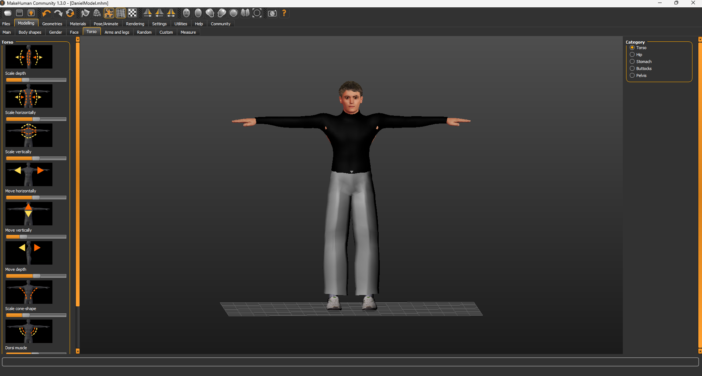

*Figure 1: The character model in MakeHuman*

### Preparing the avatar in Blender

I imported the FBX into Blender and organised the scene into a Body collection (body, top, trousers, shoes, shorts and a waist liner) and a Facial Features collection (eyebrows, eyelashes, tongue and eyes). I cleaned up the clothing around the shirt hem and cuffs and added a thin waist liner so no gap shows between the top and trousers when the character moves.

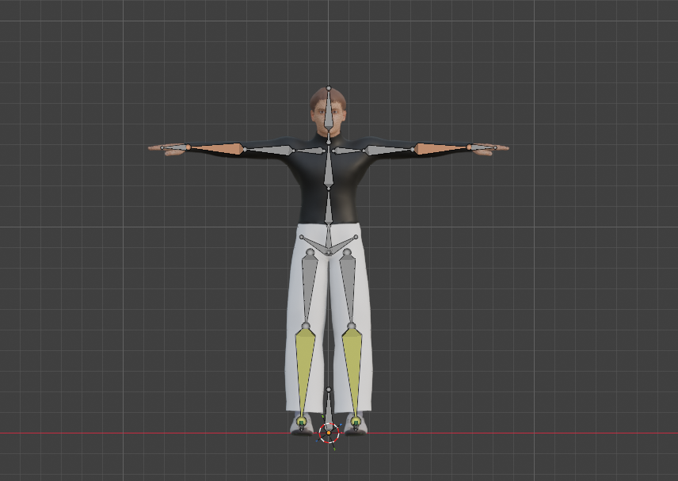

*Figure 2: Model is weighted with T pose*

### Rigging and weighting

I built an armature with a clear bone hierarchy: Main, PelvisControl, Hip, Pelvis/UpperLeg/LowerLeg/Foot/Toe for each leg, Torso, Chest, Clavicles, UpperArm/LowerArm/Hand for each arm, Neck and Head. The knees have a hinge limit so they only bend the correct way. I then weighted the meshes to the bones using vertex groups (one per bone) and tested the deformation by posing the character.

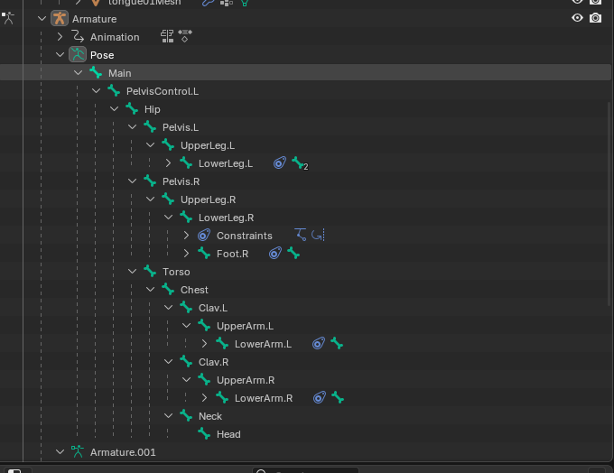

*Figure 3: Bone hierarchy of the rig*

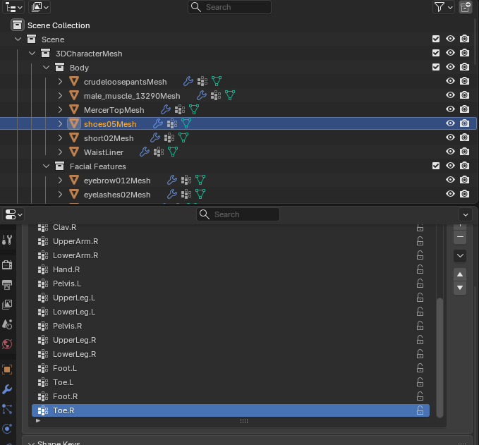

*Figure 4: Vertex groups on the shoes mesh, one for each bone used for weighting*

## Deliverable 2: Unity import and animations

### Exporting to Unity

I exported the rigged avatar from Blender as an FBX. The important settings were: only the armature and meshes selected, scale 1.0, forward -Z, up Y, primary bone axis Y and secondary bone axis X, Only Deform Bones on, Add Leaf Bones off, and textures embedded. In Unity I set the Rig type to Humanoid and created the avatar from the model, so the character could use Unity's standard animations.

I imported the Starter Assets (Third Person Controller) and replaced its character with Daniel. The Idle, Jump and Fall animations from the starter pack work on my character.

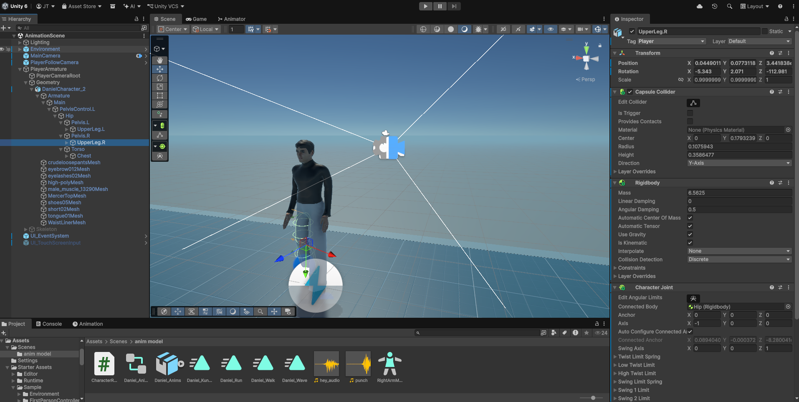

*Figure 5: Character in Wave animation*

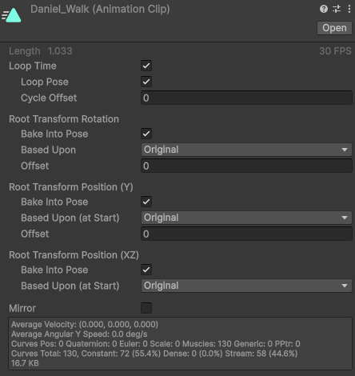

*Figure 6: Import settings of the Daniel_Walk animation clip (loop time, root transform baked into pose)*

### Animations created in Blender

I animated the character in Blender by posing the armature and inserting keyframes in the Action Editor (only the key poses, not every frame). I made four actions: Walk, Run, Wave and KungFu. Each starts from the same relaxed A-pose so the animations blend smoothly with Unity's Idle. I exported them as one FBX with Bake Animation on (Unity cannot read Blender's keyframe curves directly, so the exporter samples every frame) and with every action exported as a separate clip. 

(Click each image to watch videos)

[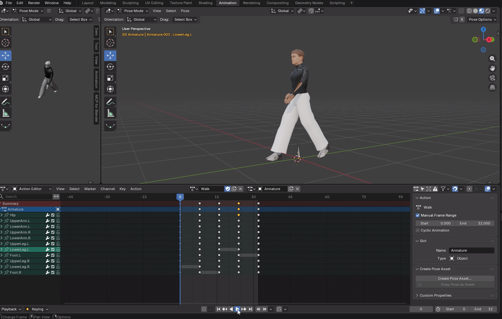](images_vids_project_report/walk.mp4)

*Figure 7: Walk action in Blender. [walk.mp4](images_vids_project_report/walk.mp4)*

[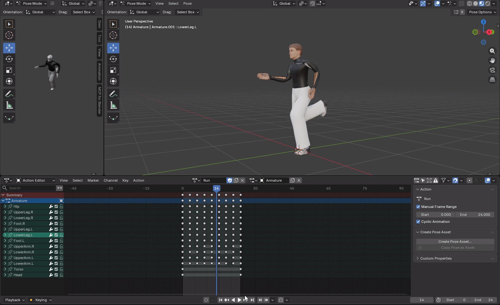](images_vids_project_report/run.mp4)

*Figure 8: Run action in Blender. [run.mp4](images_vids_project_report/run.mp4)*

[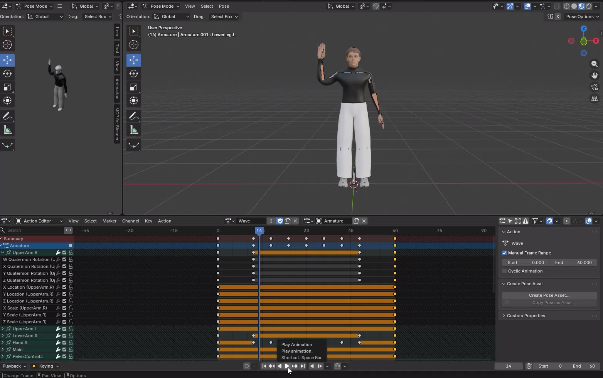](images_vids_project_report/waveVid.mp4)

*Figure 9: Wave action in Blender. [waveVid.mp4](images_vids_project_report/waveVid.mp4)*

[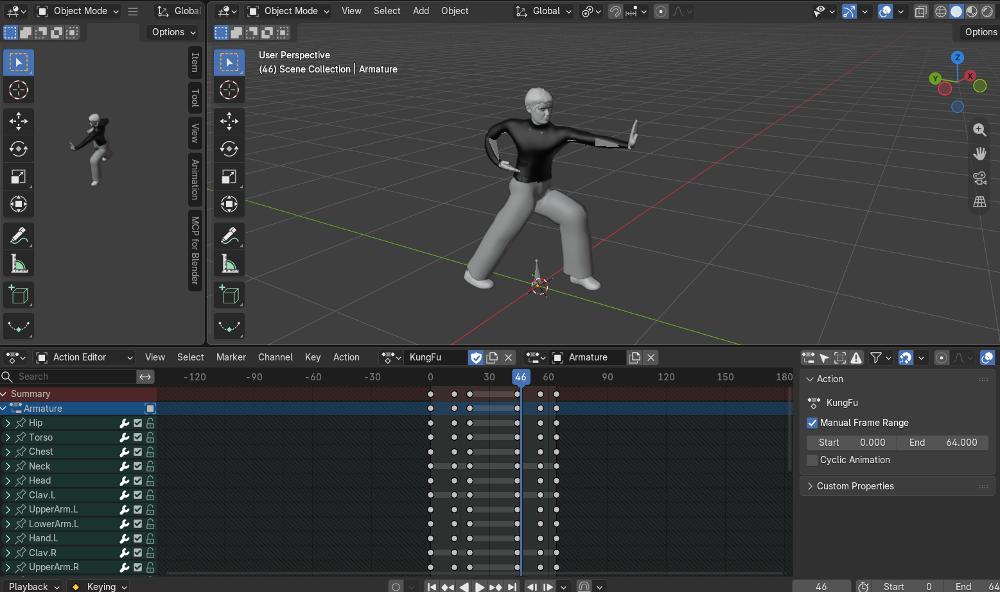](images_vids_project_report/kungFuVid.mp4)

*Figure 10: KungFu action in Blender. [kungFuVid.mp4](images_vids_project_report/kungFuVid.mp4)*

## Deliverable 3: State machine, blend trees, meta channels and ragdoll

### Animation State Machine

I made an Animator Controller (Daniel_Animator) that mixes my animations (Walk, Run, Wave and Kungfu) with the starter pack animations where I keep the starter pack's Idle, JumpStart, InAir, JumpLand. The parameters are Speed, Jump, Grounded, FreeFall, MotionSpeed and two triggers, Wave and KungFu.

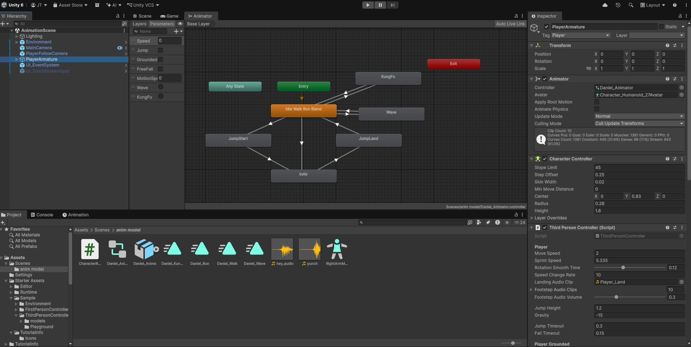

*Figure 11: The Animator window with the state machine

The Wave and KungFu states are entered from the locomotion state when their trigger is set, and the character only waves or does the kung fu pose while standing still. Both return to the locomotion state when the clip finishes.

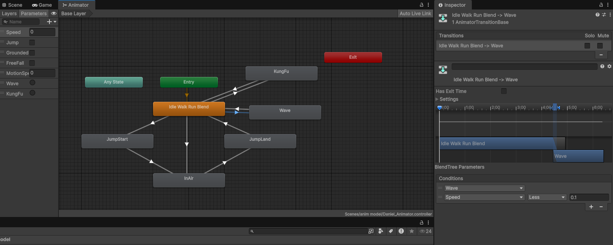

*Figure 12: Transition from Idle Walk Run Blend to Wave*

### Blend tree

The locomotion state is a blend tree driven by the Speed parameter. It blends Idle with my Walk and my Run, so the character moves smoothly from standing to walking to running.

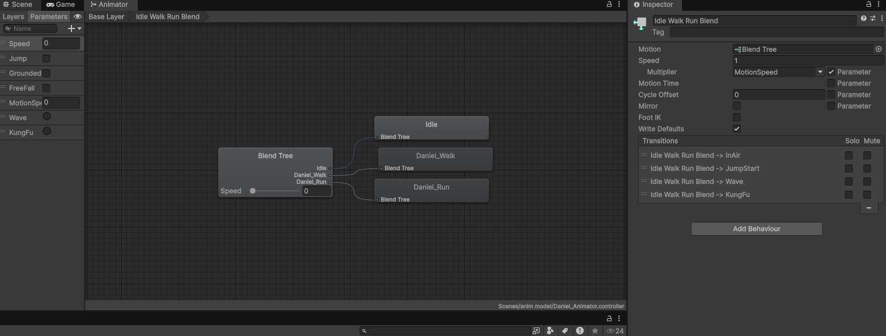

*Figure 13: Blend tree Idle / Daniel_Walk / Daniel_Run*

### Meta channels (animation events)

I used animation events in the Animation window to trigger code and sound at exact moments of a clip. Each event calls a method on the character's Third Person Controller:

- **Footsteps:** OnFootstep events on the Walk and Run clips at each foot contact, so footstep sounds match the steps.
- **Wave:** an OnWaveSound event on Daniel_Wave plays the hey_audio sound as the hand is raised. The sound clip is set in the event's Object field.
- **Kung fu:** an OnKungFuSound event on Daniel_KungFu plays the punch sound when the pose lands. It uses the same method as the wave sound, so changing the sound only means changing the Object field.

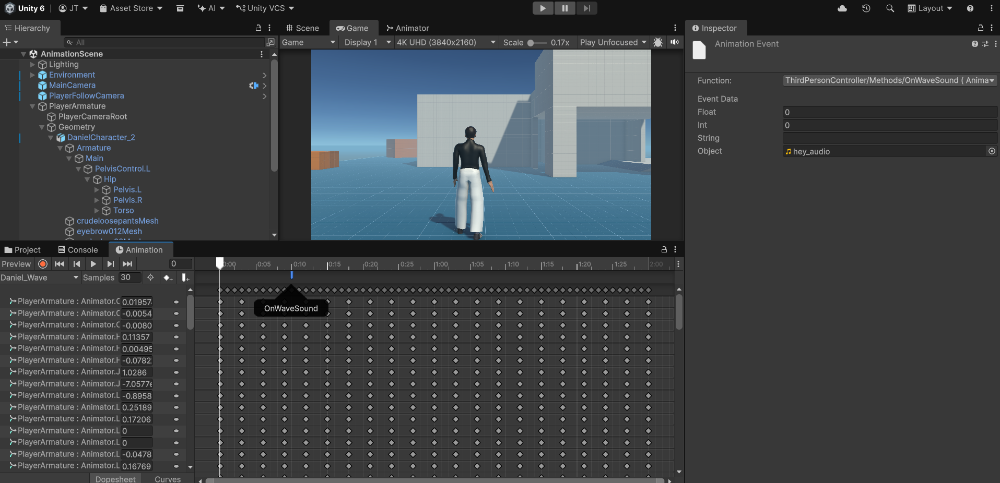

*Figure 14: OnWaveSound event on the Daniel_Wave clip with the hey_audio clip as its Object*

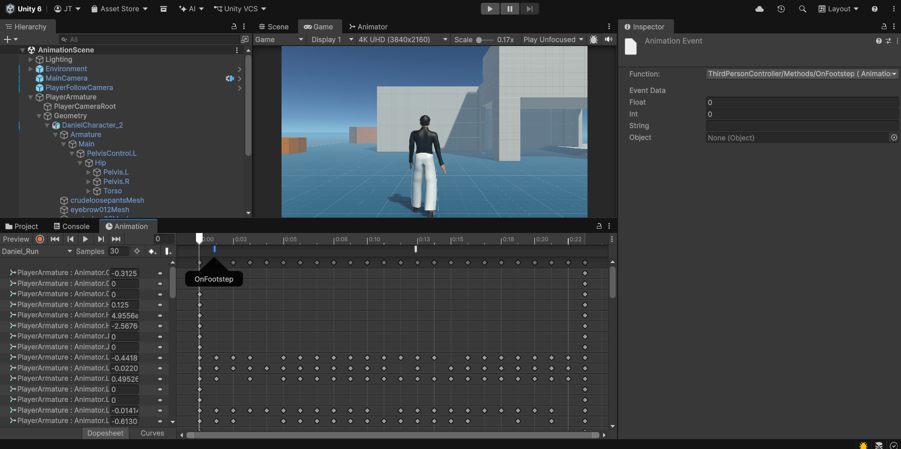

*Figure 15: OnFootstep event on the Daniel_Run clip*

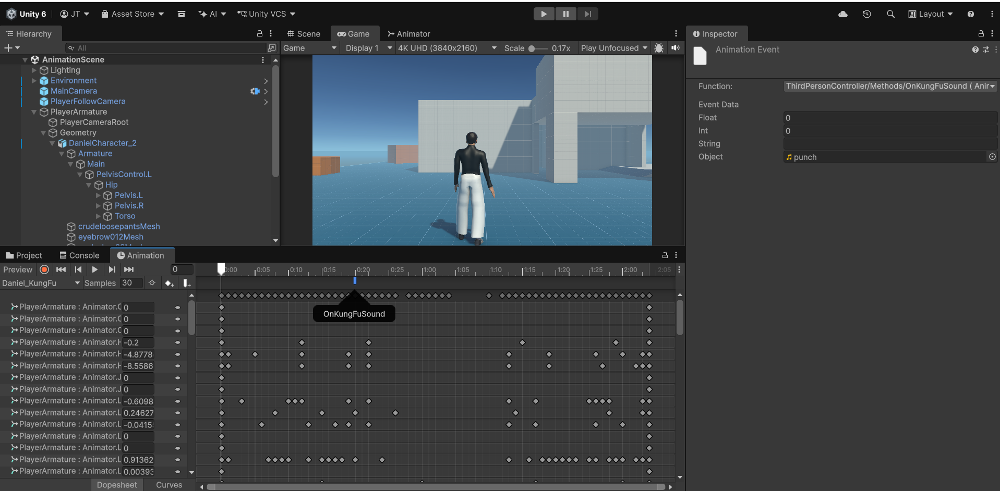

*Figure 16: OnKungFuSound event on the Daniel_KungFu clip*

### Extra animation: kung fu pose

I added a fourth animation in Blender: a kung fu stance. It is triggered with the F key (the wave uses E). I added both keys to the Input System actions and a small handler in the input script that sets the Animator trigger.

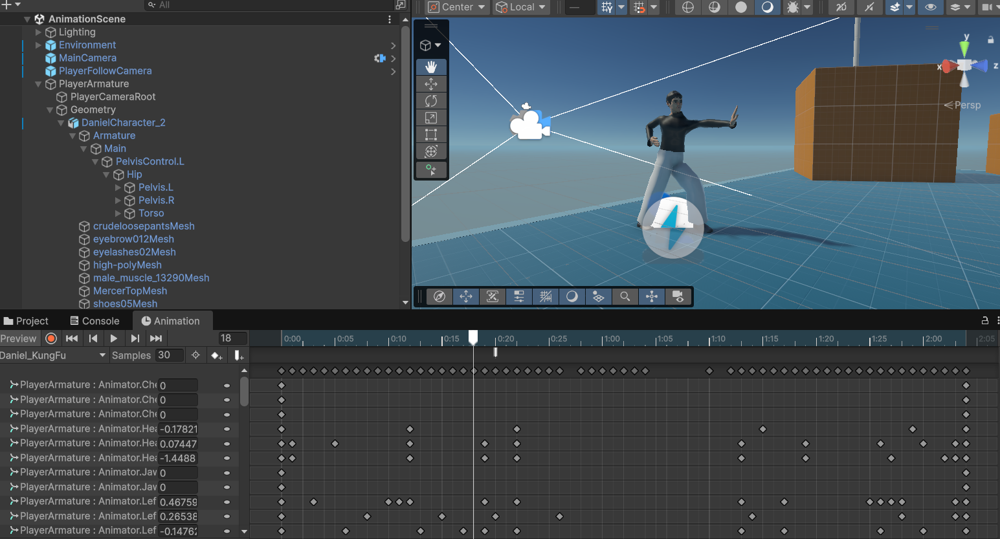

*Figure 17: The kung fu pose in Unity*

### Transition to ragdoll

I created the ragdoll with Unity's Ragdoll Wizard on the character, which added a Rigidbody, a collider and a Character Joint to 11 bones. A CharacterRagdoll script on the PlayerArmature controls it:

- **R key:** turns the ragdoll on. The script switches off the Animator, the Character Controller and the movement script, and makes every bone Rigidbody non-kinematic, so physics takes over and the character falls.
- **T key:** respawns the character. It stops the bones, puts them back to their starting pose, moves the character to its start position and switches everything back on.

I also turned off the movement script as well to stop the "CharacterController.Move called on inactive controller" error. I also tagged the bones as Player so the camera does not collide with them.

*Figure 18: Ragdoll bone setup with Rigidbody, Capsule Collider and Character Joint*

### Final demonstration

This screen recording shows the finished character in Unity Play Mode.
(Click image to watch video)

[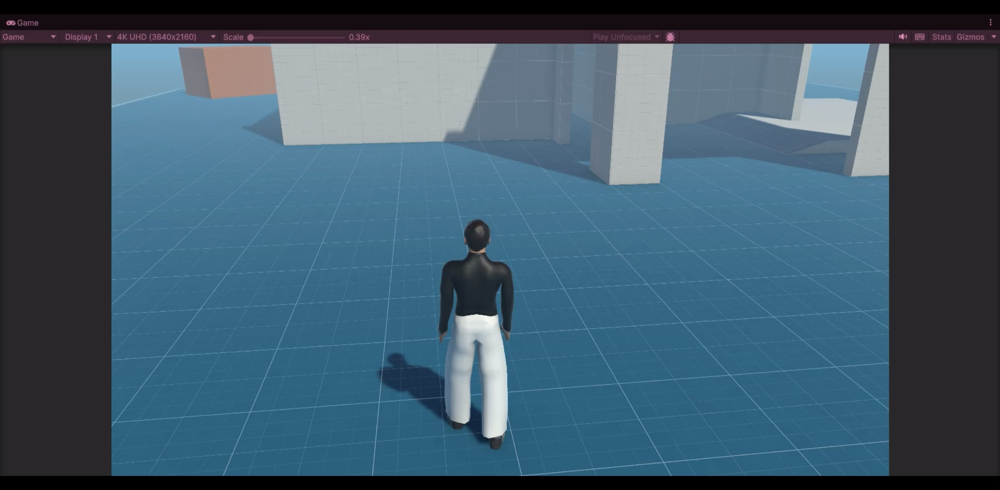](images_vids_project_report/animationClip.mp4)

*Figure 19: Unity Play Mode recording of the character: [animationClip.mp4](images_vids_project_report/animationClip.mp4)*

## Problems and how I fixed them

- **Patchy model** The model top is patchy due to close vertices rendering on top of one another so deleting the layer underneath fixed the issue.
- **Weighting Problems** Some parts of the body are deformed too much when posed so I adjust the vertices in Edit Mode to its correct vertex group influence.
- **Change animation to A pose** Unity has animation in A pose so exporting it in T pose causes the blending to not work as smoothly.
- **Left side looked different in Unity:** Unity's Humanoid retargeting twisted the left foot and hand differently from Blender. I corrected this by adjusting the left foot, leg and hand muscle in Muscles and Settings under Rig > Configure until the pose matched Blender.
- **Body leaned forward in Walk and Run:** I measured the lean against Unity's Idle and reduced the spine and neck so the posture matches Idle. I also turned Foot IK off on the locomotion state.

## References

Resources I used for this project:

1. Blender Rigging: Youtube: <https://youtu.be/eCtSviaHZ6U?si=ERV4PMqJGFzQ4N78>
2. Add an Animation Events (Unity Manual). Used to add animation events (meta channels) to the clips. <https://docs.unity3d.com/Manual/script-AnimationWindowEvent.html>
2. Starter Assets: First Person / Third Person Character Controllers (Unity Asset Store). Used for the Third Person Controller, the camera and the Idle, Jump and Fall animations. <https://assetstore.unity.com/packages/3d/characters/first-person-third-person-character-controllers-196526>
3. Character ragdoll script, which I reviewed while building the ragdoll: Youtube: <https://www.youtube.com/watch?v=xyt26Zyf6BQ>
4. Blender 2.80 Fundamentals <https://youtube.com/playlist?list=PLa1F2ddGya_-UvuAqHAksYnB0qL9yWDO6&si=jr2uvKQGwOYWYiHr>
